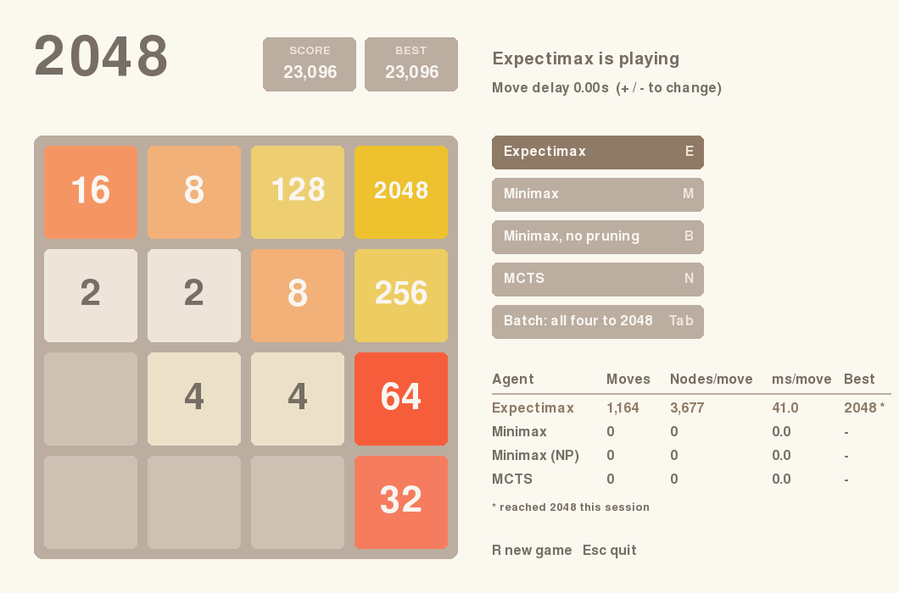

# 2048 Solver

[](https://github.com/Tarmk/2048-Solver/actions/workflows/ci.yml)

[](LICENSE)

Play 2048 yourself, or watch four search agents play it: **Expectimax**, **Minimax with alpha-beta pruning**, **plain Minimax** (to show what pruning saves) and **Monte Carlo Tree Search**. A headless benchmark plays full games and compares them.



## Results

BENCHMARK_TABLE

## How it works

**Bitboard engine** ([`solver2048/board.py`](solver2048/board.py)). The board is a single 64-bit integer, four bits per cell, holding the tile's exponent (`11` means 2048). All 65,536 possible rows are slid once at import time and stored in lookup tables, so a move is four table lookups. Up and down transpose the board with a few bit operations and reuse the left/right tables. The engine is tested against a plain list-based implementation on thousands of random boards.

**Evaluation** ([`solver2048/heuristics.py`](solver2048/heuristics.py)). Rewards empty cells and adjacent equal tiles, penalises rows and columns that are not monotonic, and lightly penalises the tile sum so merging is preferred. The weights come from [Robert Xiao's 2048 AI](https://github.com/nneonneo/2048-ai). The heuristic is also precomputed per row, so scoring a board is eight lookups.

**Agents** ([`solver2048/agents.py`](solver2048/agents.py)):

| Agent | Idea | Default setting |
|---|---|---|
| Expectimax | Max nodes for the player. Chance nodes average over every empty cell and both spawn values (2 at 90%, 4 at 10%). Branches less likely than 1 in 10,000 are cut, and chance nodes are cached within a move. | 2 plies, 3 when 3 or fewer cells are empty |
| Minimax | Treats the tile spawn as an opponent that always places the worst tile. Moves are ordered by the heuristic so alpha-beta cuts early. | 2 plies |
| Minimax, no pruning | Same search without alpha-beta. It picks the same moves, but searches roughly ten times as many nodes. | 2 plies |
| MCTS | Open-loop UCT: the tree stores move sequences, and random spawns are re-sampled on every iteration. Rollouts are random. | 300 iterations, 20-move rollouts |
| Greedy, Random | Baselines for the benchmark (one-ply heuristic and uniform random). | |

In the Pygame app the search runs on a worker thread, so the window stays responsive while an agent thinks.

## Running it

Python 3.10 or newer.

```bash
git clone https://github.com/Tarmk/2048-Solver.git
cd 2048-Solver
python -m venv .venv
source .venv/bin/activate        # Windows: .venv\Scripts\activate
pip install -r requirements.txt  # only pygame-ce
python -m solver2048             # or: python 2048.py
```

`python -m solver2048 --agent expectimax --seed 1` starts with an agent already playing.

### Controls

| Key | Action |
|---|---|
| Arrow keys / WASD | Move (when no agent is playing) |
| E / M / B / N | Start or stop Expectimax / Minimax / Minimax without pruning / MCTS |
| Tab | Batch run: each agent plays one game until it makes 2048 |
| + / - | Faster / slower agent moves |
| R | New game |
| Esc | Quit |

Buttons on the right do the same as the keys. The table under them tracks moves, nodes searched per move, thinking time per move and best tile for each agent during the session.

### Benchmark

```bash
python -m solver2048.bench                         # every agent, 10 games each
python -m solver2048.bench -a expectimax -n 50 -j 4  # one agent, 50 games, 4 processes
python -m solver2048.bench --markdown              # Markdown table, as above
```

Game *i* uses seed *i*, so every agent gets the same random spawns and runs are reproducible.

## Project layout

```
solver2048/
  board.py       bitboard engine: moves, spawns, conversions
  heuristics.py  board evaluation (precomputed per row)
  agents.py      Expectimax, Minimax, MCTS, Greedy, Random
  game.py        headless game loop shared by the UI and the benchmark
  bench.py       benchmark CLI
  ui.py          Pygame front-end
tests/           pytest: engine against a reference implementation, agent behaviour
2048.py          launcher kept for `python 2048.py`
```

## Development

```bash
pip install -r requirements-dev.txt
pytest
ruff check . && ruff format --check .
```

CI runs the tests on Python 3.10, 3.12 and 3.13, a short benchmark, and a headless run of the Pygame app.

## License

MIT, see [LICENSE](LICENSE). 2048 was created by [Gabriele Cirulli](https://github.com/gabrielecirulli/2048).
